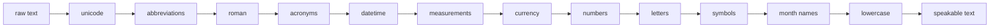

# SpeechTextNormalizer

[](https://github.com/doanan293/SpeechTextNormalizer/actions/workflows/ci.yml)

Rewrites Vietnamese text into the words a text-to-speech engine should say: dates, times, numbers, money, units, acronyms, Roman numerals and single letters. Pure Python, no runtime dependencies.

## What it does

Every row below is the real output of `normalize()` on an input taken from the test suite.

| category | input | output |
|---|---|---|
| dates and ranges | Hội nghị diễn ra từ ngày 26-28/6/2022 | hội nghị diễn ra từ ngày hai mươi sáu đến ngày hai mươi tám tháng sáu năm hai nghìn không trăm hai mươi hai |
| times | Họp lúc 7h12, kết thúc 12:00 | họp lúc bảy giờ mười hai phút, kết thúc mười hai giờ không phút |
| negatives and decimals | Giảm -1.000 điểm, còn 0,02 | giảm âm một nghìn điểm, còn không phẩy không hai |
| money | Giá 1.000.000 đồng, khoảng 50 USD | giá một triệu đồng, khoảng năm mươi đô la |
| units | Khối sapphire nặng 310 kg | khối sapphire nặng ba trăm mười ki lô gam |
| acronyms | UBND TP.HCM và CLB Bắc Kạn | uỷ ban nhân dân thành phố hồ chí minh và câu lạc bộ bắc kạn |
| Roman numerals | thế kỉ XXI | thế kỉ hai mươi mốt |
| spelled letters | H 5 N 1 | hát năm en nờ một |
| symbols | Tôi & em, tỉ lệ 3/4 | tôi và em, tỉ lệ ba trên bốn |
| abbreviations | em ko bit, v/v học sinh | em không biết, về việc học sinh |
| phone numbers | Gọi 0912345678 | gọi không chín một hai ba bốn năm sáu bảy tám |

The test suite has 1,864 cases: 138 input/output pairs carried over from the original project, 1,713 number readings checked against a reference implementation, the pipeline tests and a golden paragraph ([tests/golden](tests/golden)).

## How it works



- `pipeline.py` runs the steps in one fixed order, declared once in `STEPS`. You can run a subset with `steps=[...]`, and they still run in that order.
- Each step is a small module with a `normalize(text)` function. Regular expressions are compiled once at import.
- Lookup tables for abbreviations, acronyms, currencies and units live in TOML files under `src/speech_text_normalizer/data/`, so adding a word does not need a code change.
- `vi_number.py` reads whole numbers by place value ("một nghìn không trăm lẻ một") or digit by digit for phone numbers.
- `split_sentences` and `split_passages` cut long text into pieces a TTS model can handle.

## Quickstart

```bash
uv add git+https://github.com/doanan293/SpeechTextNormalizer
```

```python
from speech_text_normalizer import normalize, split_sentences

text = (
    "Ngày 01/02 là ngày mùng 1 Tết , tôi thêm 1 tuổi mới,cao thêm 3 cm, được lì xì 1.000.000 đồng."
)
print(normalize(text))
# ngày một tháng hai là ngày mùng một tết, tôi thêm một tuổi mới, cao thêm ba xen ti mét, được lì xì một triệu đồng.

print(normalize("A/B", steps=["symbols"]))
# A trên B

print(split_sentences("Câu một rất ngắn. Câu hai cũng ngắn! Câu ba thì sao?", max_length=6))
# ['Câu một rất ngắn.', 'Câu hai cũng ngắn!', 'Câu ba thì sao?']
```

To work on the code:

```bash
git clone https://github.com/doanan293/SpeechTextNormalizer && cd SpeechTextNormalizer
uv sync
uv run pytest
```

## Limitations

The rules are hand-written regular expressions, so they cover the patterns in the test suite and miss others. Known misreadings:

- A Roman-numeral quarter with a year, such as "quý I/2024", becomes "quý một trên hai nghìn...". Write "quý 1/2024" instead.
- A bare one-letter unit after a number, such as "25 m", is read as the letter ("mờ"), not "mét".
- A currency sign before the amount, such as "$5.000", is read before the number ("đô la năm nghìn").
- Compound domains such as ".com.vn" read "vn" as "việt nam".
- A day and month after "hôm nay", such as "hôm nay 5/10", is read as a fraction.

There is no model and no context, so words with several readings (for example "TT" as "thủ tướng" or "thông tư") always get the one in the table.

## Credits and license

MIT License, Copyright (c) 2025 Doan Van An. The English acronym list follows NVIDIA Mellotron (BSD-3), the step-by-step cleaner design follows keithito/tacotron (MIT), and the Roman numeral conversion follows a Stack Overflow answer. Full attributions and license texts are in [NOTICE](NOTICE).
